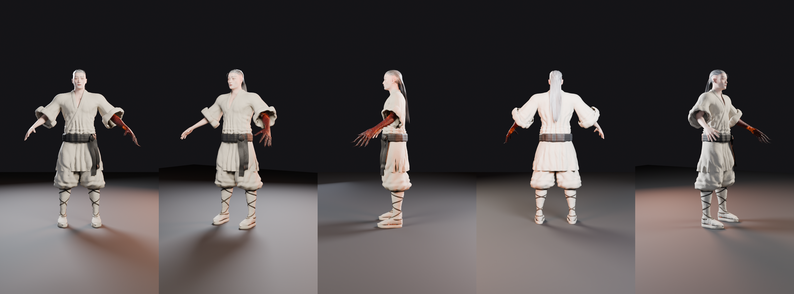
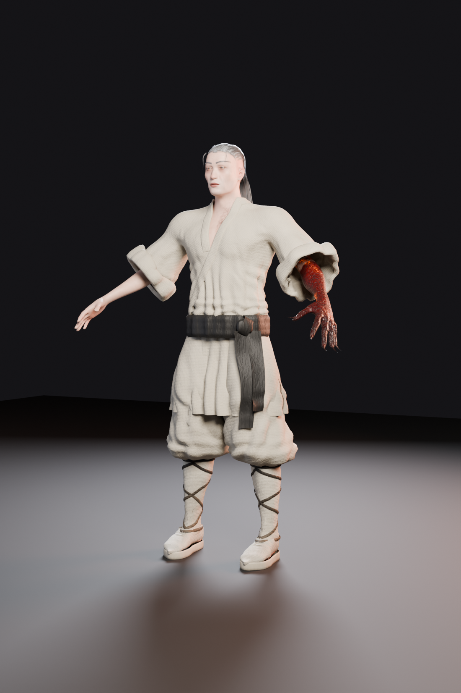
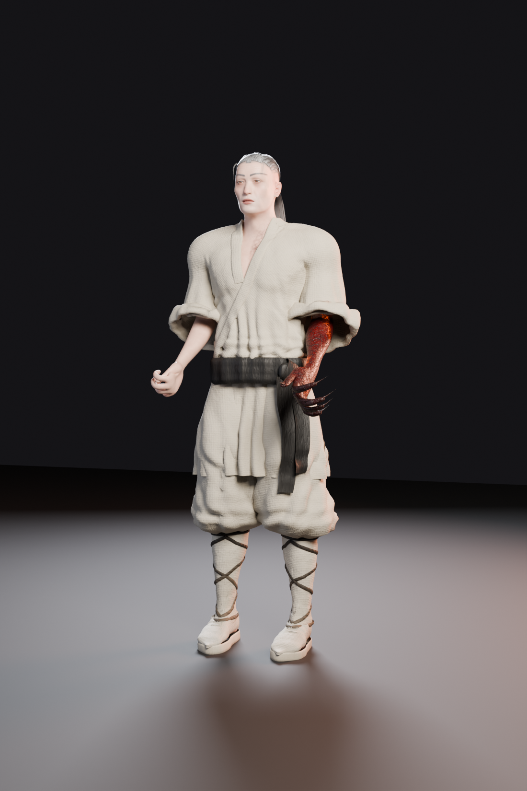
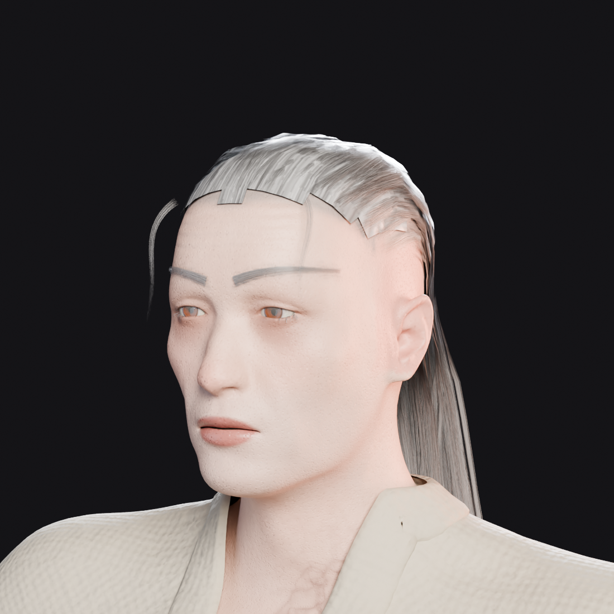
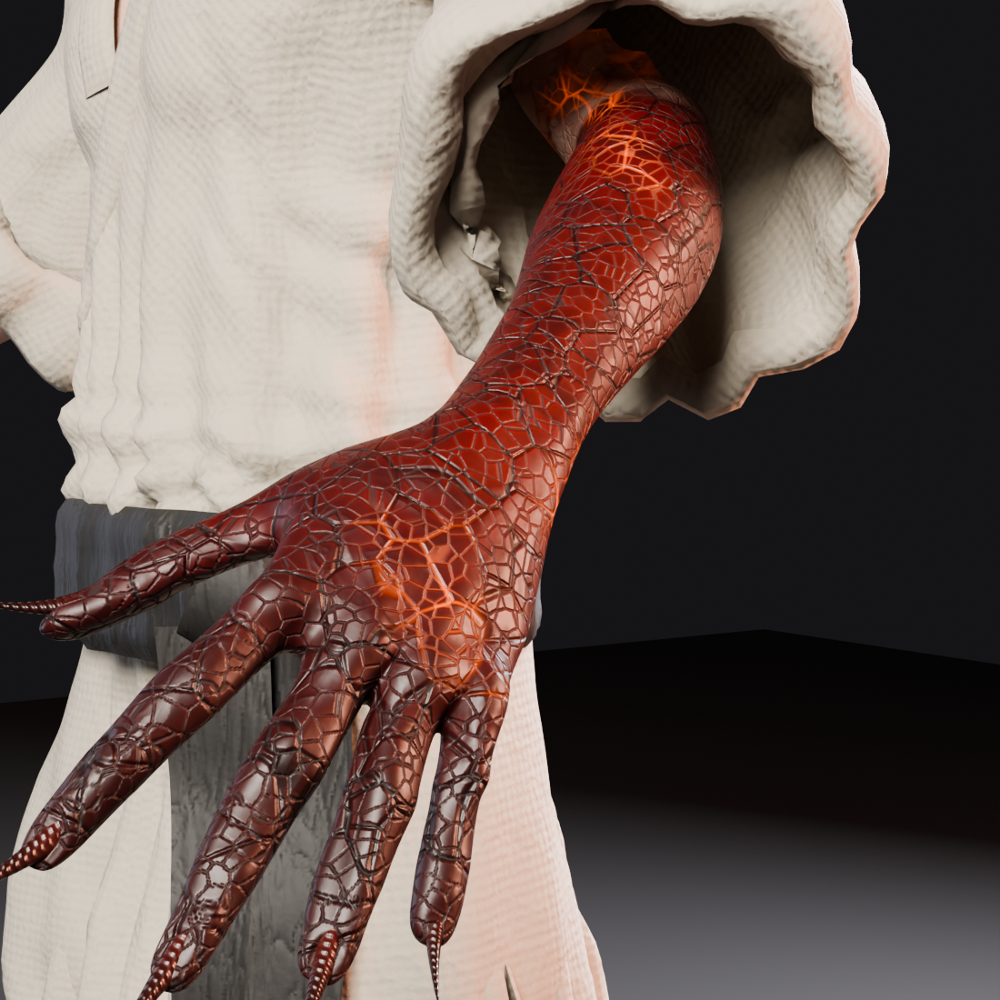

# Sura of the Red Hand

A rigged, game-ready 3D character inspired by the **Sura** class of *Metin2*: a lean
warrior-mage in plain white Shaolin training clothes, long grey hair slicked back, whose
**left forearm and hand have turned into a demon's**: crimson scaled hide, molten cracks,
bone spikes along the ulna and hooked black claws.



| | |
|---|---|
|  |  |
|  |  |

The whole asset is generated by code: `build.py` drives Blender (as the `bpy` Python module)
to sculpt, tailor, rig, skin, texture-bake and export the character. Every number below is
reproducible with one command.

## Deliverables (`export/`)

| File | What it is |
|---|---|
| `Sura.glb` | LOD0, skinned mesh + skeleton + 34 facial blendshapes + `Idle` / `Stance` clips, 2K PNG PBR textures embedded |
| `Sura.fbx` | Same as the GLB for Unreal / Unity / Maya; textures referenced from `textures/` |
| `Sura_LOD1.fbx`, `Sura_LOD2.fbx` | Decimated distance LODs (≈50 % and ≈20 % triangles, no blendshapes) on the same skeleton |
| `Sura.blend` | Source scene: rig, meshes, materials, actions (saved with Blender 5.2) |
| `textures/` | `T_Sura_*` PBR sets: BaseColor (sRGB), Normal (tangent space, OpenGL +Y), ORM (R AO, G roughness, B metallic), Emissive |
| `web/Sura_web.glb`, `web/index.html` | Lightweight copy (1K JPEG textures) and a three.js viewer; run `python -m http.server` inside `export/web` |

## Specs

| Mesh | Triangles | Materials | Contents |
|---|---:|---|---|
| `Sura_Body` | 74,844 | Skin, Horn, Hair | Visible skin (hidden areas culled, subdivided once), claws and spikes, brows and lashes; 34 blendshapes |
| `Sura_Outfit` | 110,984 | Outfit | Tunic + collar band + rolled cuffs, side-slit skirt, sash with knot and tails, trousers, calf wraps, straps, shoes |
| `Sura_Hair` | 26,204 | Hair | ≈330 alpha cards in three layers, combed scalp cap, two loose strands |
| `Sura_Eyes` | 2,040 | Eye, Cornea | MakeHuman high-poly eyes, amber-crimson irises |
| `Sura_Mouth` | 640 | Teeth, Tongue | |
| **LOD0 total** | **214,712** | 8 materials | LOD1 107,356 · LOD2 50,801 |

| Texture set | Size | Maps |
|---|---|---|
| `T_Sura_Skin_*` | 2048² | BaseColor, Normal, ORM, Emissive |
| `T_Sura_Outfit_*` | 2048² | BaseColor, Normal, ORM |
| `T_Sura_Hair_*` | 2048² | BaseColor + alpha (4 card variants, lash/brow strip, scalp strip), Normal |
| `T_Sura_Horn_*` | 512² | BaseColor, Normal, ORM |
| `T_Sura_Eye_BaseColor` | 1024² | BaseColor |

Height 1.95 m in shoes (1.92 m barefoot). Metres; Z-up in Blender, Y-up in glTF; the
character faces −Y in Blender (front view). Animation clips: `Idle` (4 s loop: breathing,
demon claws flexing, hair sway) and `Stance` (arms down, fists clenched, like the
reference photo).

**Skeleton**: 83 bones with Unreal-mannequin naming (`root`, `pelvis`, `spine_01…05`,
`neck_01/02`, `head`, `jaw`, `eye_l/r`, `clavicle`, `upperarm`, `lowerarm`,
`lowerarm_twist_01`, `hand`, metacarpals + 3 phalanges per finger, `thigh`, `calf`,
`calf_twist_01`, `foot`, `ball`) plus three 4-bone hair chains (`hair_l/c/r_01…04`) for
engine-side physics (AnimDynamics, Unity spring bones, etc.). Bone rolls follow each
joint's bend plane, so finger curls, elbows and knees all rotate around local X; left/right
rolls mirror. Rest pose is an A-pose. Skin weights come from MakeHuman's hand-weighted
default rig, collapsed onto the game skeleton and limited to 4 influences per vertex.

**Facial blendshapes**: 34 FACS-style expression units (eye closure/slit/wide, brow
up/down/inner/outer, mouth corner puller, depression, pursing, open, nose elevation/
dilatation, platysma…), applied to the skin, brows and lashes together so blinks and
brow raises keep the hair on the face aligned.

**Materials**: `M_Sura_Skin` (skin + demon arm, emissive cracks), `M_Sura_Outfit` (one 2K
atlas for every garment, double-sided), `M_Sura_Hair` (alpha-tested strand cards,
double-sided), `M_Sura_Horn` (claws / spikes), `M_Sura_Eye` + `M_Sura_Cornea`,
`M_Sura_Teeth`, `M_Sura_Tongue`.

## Art direction

- **Body**: tall (1.95 m in shoes), lean and muscular, V-shaped torso; gaunt, angular face
  with hollow cheeks, prominent cheekbones, low brooding brows, faintly pointed ears and
  amber-crimson eyes.
- **Outfit** (after the reference photo): wrap-front tunic with a crossover *youren* collar
  band, wide sleeves rolled into thick cuffs below the elbow, side-slit skirt to mid-thigh;
  black sash knotted on the left hip with two hanging tails; baggy trousers bloused over
  white calf wraps criss-crossed by black straps; white canvas sneakers with rubber soles
  (no branding). Folds are modelled: hanging folds on the sleeves and skirt, bunching above
  the sash and over the wraps; finer weave, creases and dust are in the normal/colour maps.
- **Demon arm**: corruption starts just above the elbow with a ragged edge and black veins
  that creep up the arm and onto the left side of the chest. Below it: crimson plated hide,
  ash patches, glowing fissures, swollen knuckles, knuckle spurs, four ulna spikes and claws
  that darken to black at the fingertips.
- **Hair**: about 330 layered alpha cards traced across the scalp toward the back, then
  falling with collision down to mid-back; an opaque scalp layer underneath, two loose
  strands at the temples, grey brows and lashes.

## Using it

- **Unreal Engine 5**: import `Sura.fbx` as a Skeletal Mesh with Import Morph Targets on.
  Bone names follow the UE mannequin, so UE5 animations retarget through an IK Retargeter
  once both skeletons have IK Rigs. FBX does not carry two-sidedness or alpha mode: tick
  Two Sided on the outfit and hair materials and set the hair to Masked (opacity mask from
  the BaseColor alpha). The GLB already stores both.
- **Unity**: import `Sura.fbx`, set Rig to Humanoid and check the auto-mapped avatar.
- **Blender / web**: open `Sura.blend`, or load `Sura.glb` in any glTF viewer.

## Rebuilding

```bash
python3.13 -m venv .venv && . .venv/bin/activate
pip install -r requirements.txt        # bpy 5.2 (Blender as a module), numpy, scipy, pillow
python build.py                        # ≈ 5 min on 4 CPU cores, plus ≈ 15 min of Cycles beauty renders
python build.py --tex 4096             # 4K skin / outfit sets
python build.py --quick                # 512 px textures, no LODs or renders
```

Pipeline (`src/sura/`):

| Module | Step |
|---|---|
| `mh.py`, `body.py` | Load the MakeHuman hm08 base mesh, apply macro + local morph targets (proportions, face, the swollen left forearm and long-fingered hand) |
| `rig.py` | Build the game skeleton from MakeHuman joint helpers; collapse the 163-bone MakeHuman weights onto it |
| `clothing.py`, `folds.py`, `geo.py` | Garments from MakeHuman's tights/skirt fitting shells: subdivide, ease, pseudo-cloth drape over the body, procedural folds, clean bisect cuts, collar band, cuffs, sash, knot, wraps, straps, shoes |
| `demon.py` | Corruption mask, sinew sculpt, claws, ulna spikes, knuckle spurs |
| `hair.py` | Scalp cap, traced hair cards, flyaways, brows, lashes, hair bone chains and weights |
| `assemble.py` | Skinning, culling of skin hidden under clothes, subdivision, facial blendshapes |
| `materials.py`, `nodes.py`, `texgen.py` | Procedural shaders baked with Cycles into PBR maps; hair, horn and eye textures |
| `finalize.py`, `export.py`, `render.py` | UV packing, material assignment, demo actions, LODs, GLB/FBX/.blend export, renders |

## Notes and limits

FromSoftware characters are sculpted by hand in ZBrush and textured in Substance; this one is
procedural. It has the same production structure (clean skeleton, weights, blendshapes, LODs,
baked PBR sets, alpha hair cards) and the folds, demon arm and costume read well at gameplay
distance. Up close, an artist pass would still pay off in a few places: hand-sculpted
facial detail and skin pores in the albedo, a hair card groom with more clumping, and
cloth folds simulated per pose. The `.blend` is the place to start that work.

## Credits and licence

- Base mesh, morph targets, default skeleton weights and the eye texture: **MakeHuman**
  system assets, released as **CC0 1.0**, vendored in `third_party/makehuman/`
  (see its `LICENSE.md`).
- Everything else (garments, demon arm, hair, textures, rig conversion, pipeline) is
  generated by the code in this folder.
- *Metin2* and *Elden Ring* are trademarks of their owners; this is an original character
  inspired by the Sura class and is not affiliated with either game.
